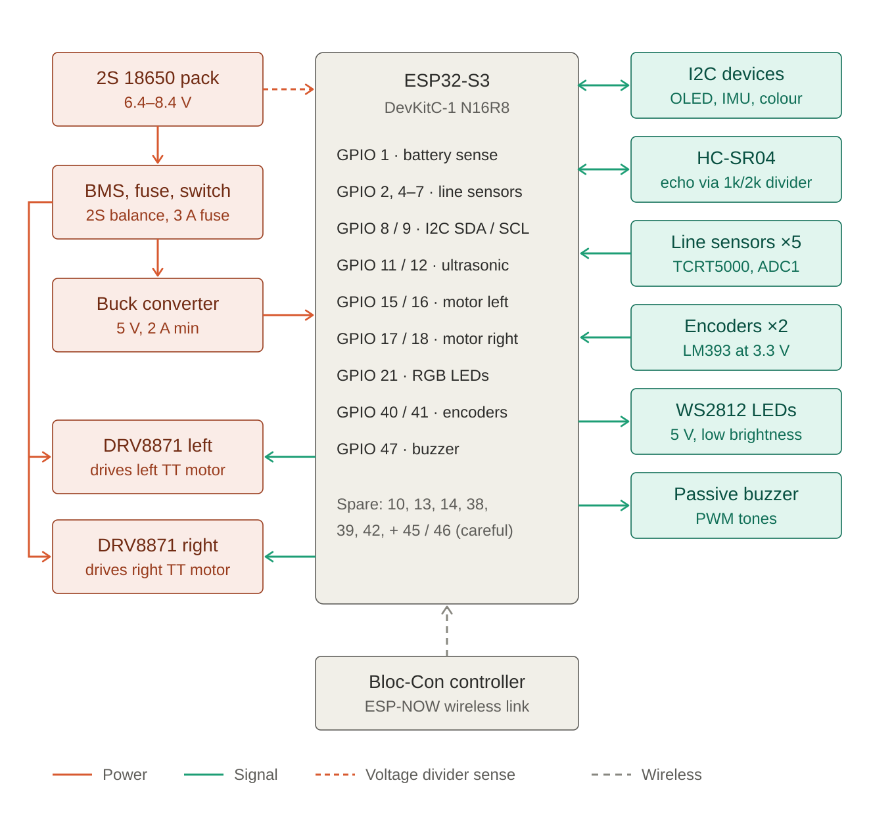

# BLOC-BOT: electronics plan

Status: **proposed** (2026-10-06; motor driver changed to the DRV8833 on 2026-10-10).
Nothing here is wired or tested yet. The robot MCU may move from the ESP32 DevKit V1 to an
**ESP32-S3-DevKitC-1 N16R8**; the pin map below is for the S3.

## Power

Robot: 2S 18650 pack (6.4–8.4 V) → 2S BMS with balancing → 3 A fuse → main switch, then:

- battery straight to the DRV8833 VM pin, with 220–470 µF there (on top of the module's
  own 10 µF ceramic);
- battery → buck converter, 5 V, at least 2 A → ESP32-S3 5V/VIN, WS2812 LEDs;
- battery → 100k/33k divider → GPIO 1 (battery sense);
- 0.1 µF ceramic across each motor's terminals.

Controller (Bloc-Con): 1 × 18650 → TP4056 + MT3608 boost → 5 V → ESP32 VIN.

All grounds are tied together: battery, buck, driver, ESP32 and every sensor.

## Motor driver: DRV8833

One DRV8833 module drives both TT motors: bridge A the left motor, bridge B the right. It
replaced the two DRV8871s on 2026-10-10, on a recommendation to the team. It also removes the
DRV8871's main problem: that chip needs at least 6.5 V and cut out at half charge on 2S.
Values from the TI datasheet (SLVSAR1E):

| | DRV8833 | What it means for BLOC-BOT |
|---|---|---|
| Motor supply (VM) | 2.7–10.8 V, 11.8 V absolute maximum | fine on 2S (6.4–8.4 V); **never use a 3S pack** (12.6 V) |
| Current per bridge | 1.5 A RMS, 2 A peak (HTSSOP/WQFN chip); only 0.5 A RMS in the plain TSSOP | a TT motor runs at 0.2–0.4 A; check which chip the module has (HTSSOP has a metal pad underneath) |
| Overcurrent cut-out | 2–3.3 A; that bridge switches off, nFAULT goes low, retry after 1.35 ms | a stalled motor stutters instead of burning out |
| Undervoltage lockout | below 2.5 V | the driver runs almost to an empty pack, so the firmware battery cutoff matters |
| Logic inputs | high from 2 V (nSLEEP from 2.5 V); internal pull-downs | 3.3 V from the ESP32 is enough |

Wiring (module labels vary; alternatives in brackets):

| DRV8833 pin | Connect to |
|---|---|
| VM (VCC, VIN) | battery after the switch, 220–470 µF to GND |
| GND | common ground |
| AIN1 / AIN2 (IN1 / IN2) | GPIO 15 / 16 |
| BIN1 / BIN2 (IN3 / IN4) | GPIO 17 / 18 |
| AOUT1 / AOUT2 | left TT motor |
| BOUT1 / BOUT2 | right TT motor |
| nSLEEP (SLP, EEP, STBY) | GPIO 14, or 3.3 V. It is pulled low inside the chip, so on GPIO 14 the motors stay off while the ESP32 boots and until the firmware enables them |
| nFAULT (FLT, ULT) | GPIO 13 with `INPUT_PULLUP` (optional; open-drain, low on overcurrent or overheating) |
| AISEN / BISEN | GND (no current limiting; most modules already wire them to GND) |

Control is the same IN1 / IN2 scheme as the DRV8871, per bridge: `10` forward, `01` reverse,
`00` coast, `11` brake. For speed, either PWM IN1 with IN2 low (fast decay), or hold IN1 high
and PWM IN2 (slow decay; the duty is inverted, so 100 % on IN2 is brake). Slow decay gives
steadier low speeds.

## Robot pin map (ESP32-S3, proposed)

| GPIO | Use | Notes |
|---|---|---|
| 1 | Battery sense | ADC1, through the divider |
| 2, 4, 5, 6, 7 | Line sensors ×5 (TCRT5000) | ADC1; GPIO 3 skipped (strapping) |
| 8 / 9 | I2C SDA / SCL | OLED face, MPU6050, TCS34725 |
| 11 / 12 | HC-SR04 TRIG / ECHO | ECHO through a 1k/2k divider (5 V → 3.3 V) |
| 13 | DRV8833 nFAULT | optional; `INPUT_PULLUP` |
| 14 | DRV8833 nSLEEP | high = motors enabled |
| 15 / 16 | DRV8833 AIN1 / AIN2 (left motor) | |
| 17 / 18 | DRV8833 BIN1 / BIN2 (right motor) | |
| 21 | WS2812 data | keep brightness low (up to 60 mA per LED) |
| 40 / 41 | LM393 encoders L / R | sensors powered at 3.3 V |
| 47 | Passive buzzer | PWM tones |
| spare | 10, 38, 39, 42; 45/46 with care | 38 is the onboard RGB LED on DevKitC v1.1 |

Not usable on N16R8: 35–37 (octal PSRAM). Kept for upload/serial: 43/44 (UART0) and 19/20
(native USB). Avoid 0, 3, 45, 46 for anything that could be pulled high at boot. With
WiFi/ESP-NOW running, only ADC1 (GPIO 1–10) can read analog values.

Count: about 27 usable GPIOs; the table above uses 20, leaving 4 spare (10, 38, 39, 42)
plus 45/46 with care. Wiring nSLEEP to 3.3 V and leaving nFAULT unconnected frees 13 and 14.

## Build steps

1. **Bench tests, one part at a time:** ESP32 + the DRV8833 + one TT motor (direction, PWM,
   nSLEEP); one encoder (count pulses by hand, then with the motor); controller buttons,
   joystick, OLED and HC-SR04 with the existing Bloc-Con code.
2. **Power:** build the robot power chain and the controller power chain above.
3. **Integration:** both motors and encoders on the plate, battery sense, then the
   ESP-NOW link from Bloc-Con to the robot (the empty "Start" menu item).
4. **Firmware protections:** PWM soft-start, encoder stall cutoff, low-battery cutoff,
   motors stop if the link is lost for more than 300 ms.
5. **Add-ons:** OLED face, RGB LEDs, buzzer, line sensors, IMU, colour sensor.
6. **Final wiring:** breadboard → perfboard or PCB, screw terminals for motors and battery.
7. **Floor tests:** measure current draw and runtime (data for the thesis).

## Known risks

| Issue | Why | Fix |
|---|---|---|
| Battery drained too far | the DRV8833 keeps working down to 2.7 V, so nothing else stops the motors on a low pack | firmware low-battery cutoff at 6.6–6.8 V (3.3–3.4 V per cell); the BMS cutoff is only the last resort |
| DRV8833 destroyed | motor supply above 10.8 V (11.8 V absolute maximum) | 2S only; never a 3S pack (12.6 V) |
| DRV8833 does nothing | nSLEEP low (pulled down inside the chip, or the module's SLP/EEP pin left open) | drive nSLEEP high from GPIO 14, or tie it to 3.3 V |
| Motor stutters when blocked | stall current above the 2–3.3 A cut-out: the bridge switches off and retries every 1.35 ms | encoder stall cutoff in firmware; read nFAULT |
| Driver weak or hot | some modules use the plain TSSOP DRV8833 (0.5 A RMS instead of 1.5 A) | check the chip on the module |
| TT motors over-volted | rated 3–6 V; the DRV8833 drops almost nothing, so they see up to 8.4 V | cap PWM duty at ~70 % |
| ESP32 resets when motors start | inrush pulls the supply down (brownout) | soft-start, bulk caps, separate 5 V buck |
| Noisy encoder counts | motor noise on signal wires | motor caps, separate encoder and motor wiring, software debounce |
| Controller won't boot | UP button on GPIO 12 (strapping pin) | button to GND with INPUT_PULLUP, no external pull-up; or move it |
| HC-SR04 echo is 5 V | ESP32 pins are 3.3 V | 1k/2k divider on ECHO |
| ADC2 dead with WiFi | ESP-NOW uses the WiFi radio | analog only on ADC1 |
| 2S cells drift apart | unbranded, unmatched cells | balancing BMS; proper 2S charger or charge cells separately |
| Odd logic behaviour | no common ground | tie all grounds together |

## Simulation and documentation tools

| Tool | Use |
|---|---|
| **Wokwi** (VS Code + PlatformIO) | Runs the real ESP32 firmware with OLED, buttons, joystick, HC-SR04. No DC motor driver part. |
| **KiCad** | Proper schematics, and a PCB later |
| **Fritzing** | Breadboard-style wiring pictures |
| Proteus (optional) | Only if the supervisor requires it; it does not really simulate the ESP32 |
